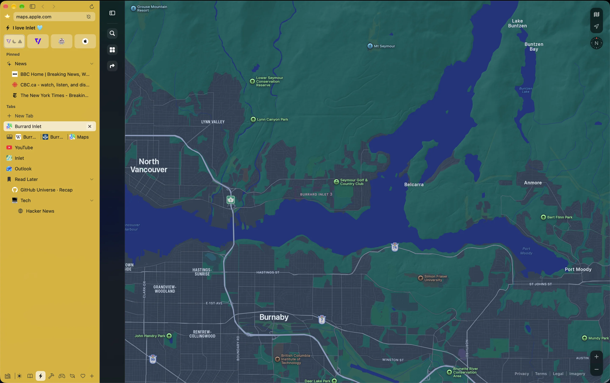

#  Inlet

A WebKit browser for the Mac, with Arc's Spaces, pinned tabs and favorites. Free, with no account, no telemetry and no AI features.

<p>
  <a href="https://github.com/colbytimm/inlet-releases/releases/latest"></a>
  
  <a href="https://github.com/colbytimm/homebrew-tap"></a>
</p>

<p>
  <a href="https://inletbrowser.com">Website</a> ·
  <a href="https://github.com/colbytimm/inlet-releases/releases">Release notes</a> ·
  <a href="https://github.com/colbytimm/inlet-releases/issues/new/choose">Report a bug or request a feature</a>
</p>



This repository holds Inlet's release builds and its issue tracker. The source code isn't public.

## Install

With [Homebrew](https://brew.sh):

```sh
brew install --cask colbytimm/tap/inlet
```

Or download `Inlet-<version>.zip` from the [latest release](https://github.com/colbytimm/inlet-releases/releases/latest), unzip it, and move `Inlet.app` to your Applications folder.

Inlet needs macOS 15.4 or later. One build runs on both Apple silicon and Intel Macs. Every build is signed with a Developer ID and notarized by Apple.

### Updating

Inlet doesn't update itself yet. To get a new version:

```sh
brew upgrade --cask inlet
```

If you installed from the zip, download the latest release and replace `Inlet.app`.

### Uninstalling

```sh
brew uninstall --cask inlet         # keeps your Spaces, tabs and settings
brew uninstall --zap --cask inlet   # removes them too
```

## Coming from Arc

Open **File › Import from Arc** and pick which Arc profiles to bring over, and which Inlet profile each one joins. Inlet imports:

- Spaces, with their names, icons and theme colors
- pinned tabs, including tabs you renamed
- folders, nested as they were (live folders become plain folders)
- favorites
- open tabs and splits
- the last 90 days of history
- Air Traffic Control routes, as Lighthouse rules

Passwords, cookies, extensions, Boosts and Easels stay in Arc. Inlet shows you how to move your passwords into the Passwords app, and it fills them from iCloud Keychain after that. Importing again won't make duplicates.

## What's in it

Tabs live in a sidebar, sorted into Spaces. Each Space has its own pinned tabs, folders, today's tabs and colors, and every Space on a profile shares the favorites across the top. Put a Space on its own profile and it gets its own cookies, logins and history, so work and personal browsing stay apart.

Split view shows up to 16 pages in one window, with 18 layouts built in and a grid editor for drawing your own. The command bar (⌘T) takes an address, a search, part of an open tab's name from any Space, or a page from your history.

Links from other apps can open in Little Inlet, a small floating window, and ⌘O moves the page into a Space if you want to keep it. Lighthouse rules send links to a Space or a Little Inlet by site, by address or by the app they came from.

Zap hides any part of a page, like a cookie banner or a sticky header, on that site for good. Ads and trackers are blocked with EasyList and EasyPrivacy, built in, and a per-site switch turns blocking off where it breaks a page.

A few shortcuts to start with:

| Shortcut | Action |
| --- | --- |
| ⌘T | Open the command bar for a new tab |
| ⌃1 to ⌃9 | Switch Space |
| ⌘1 to ⌘9 | Jump to a favorite or sidebar item |
| ⌘S | Show or hide the sidebar |
| ⇧⌘T | Reopen the last closed tab |
| ⌥⌘N | New Little Inlet window |

## Extensions

Inlet runs extensions through WebKit, the way Safari does. Install them from the Chrome Web Store or Firefox Add-ons with **Add to Inlet** on the extension's store page, or use Safari extensions already on your Mac. Manage them in **Settings › Extensions**, and choose which sites each one can run on.

WebKit doesn't offer every API Chrome does, so some extensions won't work:

- Extensions that block web requests can't, so uBlock Origin doesn't work. uBlock Origin Lite does.
- Extensions don't run in incognito windows yet.

## Privacy

Inlet collects nothing. It has no analytics, no telemetry, no crash reporting and no account. It connects to the sites you visit, your search engine, and the extension stores when you install or update an extension. Nothing you type in the command bar leaves your Mac until you press Return. The ad-blocking lists ship inside the app, so blocking needs no network either.

## Known limitations

- Passkeys and security keys don't work yet. They need a permission from Apple that Inlet doesn't have yet. Signing in with a password works.
- iCloud sync isn't built yet. When it comes, it will be off until you turn it on.
- Inlet doesn't update itself. Use `brew upgrade` or download each release.
- Inlet for iPhone and iPad is in development and isn't available yet.

## Feedback

Found a bug or want something added? [Open an issue](https://github.com/colbytimm/inlet-releases/issues/new/choose). The forms ask for your Inlet and macOS versions, which helps a lot with bugs.

Each [release](https://github.com/colbytimm/inlet-releases/releases) lists what changed.

## About

Inlet is made by Colby Timm. It's a passion project: Arc was my daily browser, and I missed it. Inlet is free, has no funding and doesn't make money.
